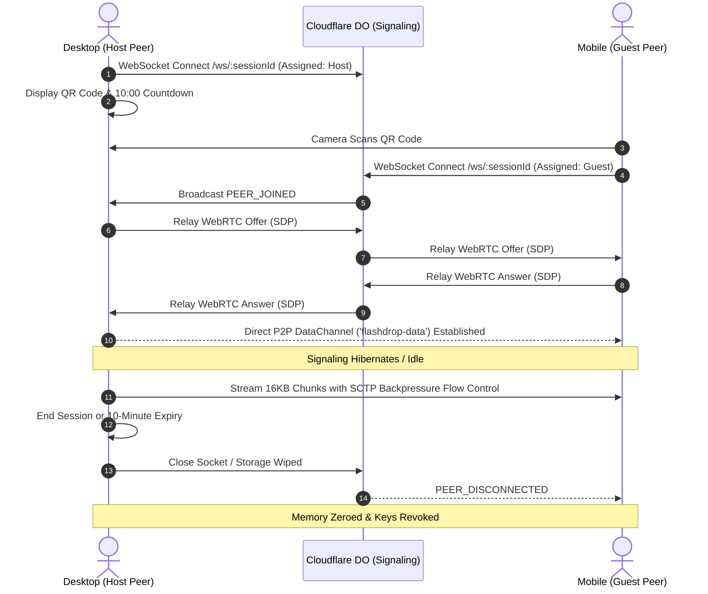

# FlashDrop ⚡

> **Ephemeral, Direct P2P File Transfer across Devices via WebRTC & Cloudflare Workers Durable Objects**

FlashDrop establishes an encrypted, direct WebRTC peer-to-peer data channel between desktop and mobile devices using QR codes and an ephemeral signaling relay on Cloudflare Workers with Durable Objects. Files stream directly between devices in 16KB chunks with SCTP backpressure flow control—**zero cloud storage, zero file persistence, zero tracking**.

---

## ⚡ System Architecture



---

## 🛠️ Tech Stack & Design System

- **Frontend (`/web`)**:
  - React 19, TypeScript, Vite 6, Tailwind CSS
  - Swiss Minimalist / Dark Tactical Aesthetic: Obsidian `#0A0A0B` background, `#141416` surface cards, `#26262A` hairline borders, `#FF4D00` Signal Orange progress bars, `#10B981` Direct P2P indicator
  - Fonts: Inter & JetBrains Mono (tabular figures)
  - Full-state management: Waiting / QR Scan &rarr; Connecting / Handshake &rarr; Connected Workspace &rarr; Dissolved State
  - Screen WakeLock & navigation guards during active transfers
- **Backend Signaling (`/worker`)**:
  - Cloudflare Worker with Durable Objects
  - Modern WebSocket Hibernation API (`ctx.acceptWebSocket`)
  - Strict 2-peer connection enforcement (Host = 1st, Guest = 2nd, 3rd rejected with code `4003`)
  - 10-minute auto-destruct alarm lifecycle with complete storage wipe
  - 32KB payload size guard
- **P2P Transfer Protocol**:
  - 16KB binary chunked streaming over ordered reliable DataChannel
  - SCTP backpressure control (pause > 256KB, resume at bufferedamountlow threshold 64KB)
  - Pre-remoteDescription ICE candidate queueing and automatic ICE restart

---

## 🚀 Quickstart & Development

### 1. Install Dependencies
```bash
# Backend Signaling Worker
cd worker
npm install

# Frontend Web Application
cd ../web
npm install
```

### 2. Run Test Suites
```bash
# Worker Unit & Integration Tests (16 tests)
cd worker
npm test

# Web Unit Tests
cd ../web
npm test
```

### 3. Type Checking & Verification
```bash
# Worker Type Check
cd worker
npx tsc --noEmit

# Web Type Check & Production Build
cd ../web
npm run build
```

### 4. Local Development
```bash
# In terminal 1 (Signaling Worker on port 8787):
cd worker
npm run dev

# In terminal 2 (Web Client on port 5173):
cd web
npm run dev
```

---

## 🌐 Deployment

### Cloudflare Worker
```bash
cd worker
npx wrangler deploy
```

### Cloudflare Pages
```bash
cd web
npm run build
npx wrangler pages deploy dist --project-name=flashdrop
```

---

## 📄 License
MIT
