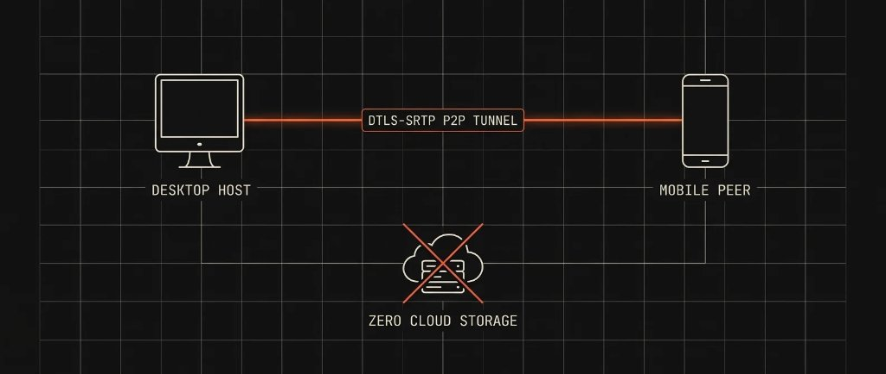
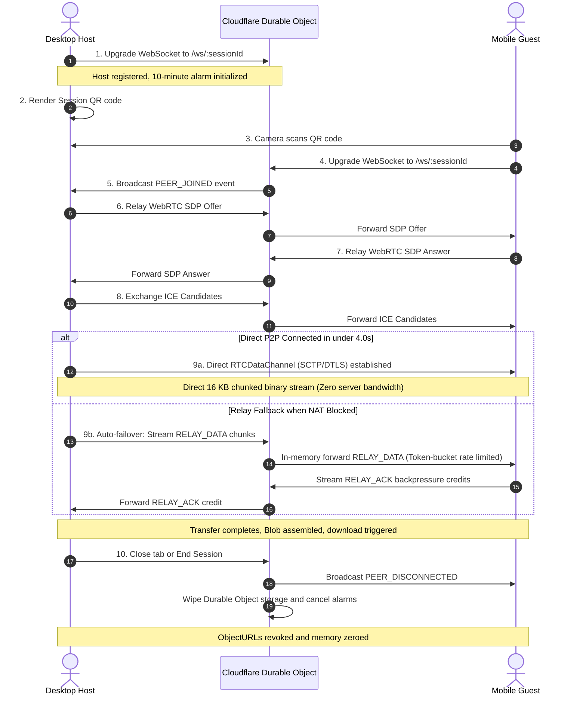

<p align="center">
  
</p>

<p align="center">
  <strong>Instant, zero-account, QR-initiated peer-to-peer file transfer engine.</strong><br />
  Direct browser-to-phone streaming over WebRTC DataChannels with seamless Cloudflare WebSocket relay fallback.<br />
  No cloud storage. No databases. No accounts. Every room dissolves without a trace.
</p>

<p align="center">
  <a href="https://getflashdrop.pages.dev"></a>
  <a href="https://github.com/devadarshmay-eng/flashdrop/actions"></a>
  <a href="#security--ephemerality-invariants"></a>
  <a href="#license"></a>
</p>

<p align="center">
  <a href="#key-features">Features</a> &bull;
  <a href="#live-deployments">Live Deployments</a> &bull;
  <a href="#architecture--transport-pipeline">Architecture</a> &bull;
  <a href="#technical-specifications">Specifications</a> &bull;
  <a href="#security--ephemerality-invariants">Security Model</a> &bull;
  <a href="#local-development">Getting Started</a> &bull;
  <a href="#testing--verification">Testing</a> &bull;
  <a href="#license">License</a>
</p>

---

## Overview

**FlashDrop** solves the common annoyance of transferring photos, videos, and documents between desktop computers and mobile devices without messaging apps, email attachments, USB cables, or third-party cloud drives.

Opening the web app generates an ephemeral cryptographic session ID (`crypto.randomUUID()`), renders an ultra-crisp high-contrast QR code, and connects to a Cloudflare Durable Object signaling channel. Scanning the QR code with any mobile camera instantly bridges the two devices over an encrypted, peer-to-peer WebRTC DataChannel.

If devices are on separate networks (e.g. cellular 4G/5G CGNAT vs. home Wi-Fi) where direct UDP hole-punching is mathematically blocked by symmetric NAT, FlashDrop **automatically degrades within 4.0 seconds to an in-memory Cloudflare WebSocket relay tunnel**, maintaining transfer continuity without user intervention.

---

## Key Features

- **Instant Zero-Friction UX:** No accounts, passwords, email verifications, pairing codes, or native app installations.
- **QR-Initiated Pairing:** Scan the desktop QR code using native iOS Camera or Android Lens to instantly open `/s/<sessionId>` and begin handshaking.
- **Dual-Engine Transport Pipeline:**
  - **Primary (Direct P2P):** Low-latency, high-throughput `RTCDataChannel` (SCTP over DTLS) using Google & Cloudflare STUN servers.
  - **Fallback (Encrypted Relay):** Seamless 4-second failover to Cloudflare Workers WebSocket Hibernation relay with credit-based sliding window backpressure.
- **16 KB Binary Chunking & SCTP Flow Control:** Files stream in 16,384-byte binary slices with dynamic backpressure thresholds (`64 KB` low-water mark, `256 KB` pause threshold) to prevent Out-Of-Memory (OOM) browser tab crashes on mobile devices.
- **Non-AI Precision UI:** Built according to modern design tokens—Obsidian `#0A0A0B` background, `#141416` surface cards, `#26262A` hairline borders, and `#FF4D00` Signal Orange progress accents.
- **Real-Time Telemetry:** Monospace (`JetBrains Mono`) tabular metrics displaying live transfer rate in `MB/s`, percentage progress bars, directional arrows (`↑`/`↓`), and one-click batch **Save All** actions.
- **Mobile Screen Wake Lock:** Automatically acquires `navigator.wakeLock.request('screen')` during active transfers to prevent mobile display sleep and socket interruption.
- **Strict Ephemerality:** Hard 2-peer cap (`4003: Room Full`), 10-minute server-enforced alarm TTL, and instant cryptographic state zeroing on tab closure.

---

## Live Deployments

| Component | Provider | Live URL | Status |
| :--- | :--- | :--- | :--- |
| **Web Client** | Cloudflare Pages | [https://getflashdrop.pages.dev](https://getflashdrop.pages.dev) |  |
| **Signaling Service** | Cloudflare Workers | [https://flashdrop-signaling.wick47501.workers.dev](https://flashdrop-signaling.wick47501.workers.dev) |  |
| **Health Check** | Cloudflare Workers | [GET /health](https://flashdrop-signaling.wick47501.workers.dev/health) |  |
| **CI/CD Pipeline** | GitHub Actions | [Workflow Runs](https://github.com/devadarshmay-eng/flashdrop/actions) |  |

---

## Architecture & Transport Pipeline

FlashDrop enforces strict separation between **ephemeral connection coordination** and **file payload transport**:

<p align="center">
  
</p>

### Connection Lifecycle Sequence



---

## Technical Specifications

| Metric / Parameter | Direct WebRTC Mode | WebSocket Relay Mode |
| :--- | :--- | :--- |
| **Transport Layer** | `RTCDataChannel` (SCTP over DTLS) | WebSocket (WSS on Port 443) |
| **Relay Infrastructure** | None (Direct P2P Hole-Punched) | Cloudflare Durable Objects (`TransferRoom`) |
| **Chunk Size** | `16,384` bytes (16 KB) | `16,384` bytes (16 KB) |
| **Max Frame Payload Guard** | N/A (Handled by browser SCTP) | `32,768` bytes (32 KB limit) |
| **Flow Control Mechanism** | SCTP `bufferedAmountLowThreshold` (64 KB / 256 KB) | Credit Sliding Window (8 unacked chunks / 128 KB in-flight) |
| **Rate Limiter** | Hardware & Network Bound | Token Bucket: `200 msg/sec` per socket |
| **Security Encryption** | End-to-End DTLS-SRTP | TLS 1.3 in-transit (Zero disk persistence) |
| **Ideal Network Conditions** | Same Wi-Fi, Full-Cone / Restricted NAT | Cross-Network, Cellular 4G/5G CGNAT, Corporate Firewalls |

---

## Security & Ephemerality Invariants

1. **Strict 2-Peer Hard Cap:** Each session accommodates exactly one `host` and one `guest`. Any unauthorized 3rd socket connection attempt is rejected immediately with WebSocket close code `4003: Room Full` without disturbing the active transfer.
2. **Deterministic Auto-Destruct (10-Minute TTL):** When a room is created, the Durable Object sets an internal alarm via `this.ctx.storage.setAlarm(Date.now() + 10 * 60 * 1000)`. When the timer expires, the server broadcasts `SESSION_EXPIRED`, drops all sockets (`4000`), and runs `this.ctx.storage.deleteAll()`.
3. **Instant Disconnect Purge:** If either peer closes their browser tab or clicks **End Session**, the remaining peer receives `PEER_DISCONNECTED`, all sockets close, and state is zeroed.
4. **Zero Persistent Storage:** FlashDrop uses **no** D1 SQL databases, **no** KV key-value stores, **no** R2 object buckets, **no** cookies, and **no** client-side `localStorage` transfer records.
5. **Memory Safety & Sandbox Lifecycle:** When a file finishes streaming, client-side ObjectURLs are created solely for user download triggers and are programmatically revoked upon session termination.

---

## Project Structure

```
flashdrop/
├── .github/
│   └── workflows/
│       └── deploy.yml            # CI/CD: Typecheck, Vitest, Playwright E2E, & Cloudflare Deploy
├── docs/
│   ├── architecture.png          # High-resolution architectural diagram
│   └── banner.png                # Project hero banner
├── tests/
│   └── e2e/
│       └── transfer.spec.ts      # Multi-browser Playwright test (Direct P2P & Relay Fallback)
├── web/                          # React + TypeScript + Tailwind CSS Frontend
│   ├── public/
│   │   ├── _redirects            # Cloudflare Pages SPA rewrite rules
│   │   ├── apple-touch-icon.png  # Programmatic mobile bookmark icon (180x180)
│   │   ├── favicon.svg           # Scalable geometric lightning mark
│   │   └── og-image.png          # Social preview card (1200x630)
│   ├── src/
│   │   ├── components/           # State views (Waiting, Connecting, Connected, Expired)
│   │   ├── lib/                  # WebRTC core, 16 KB chunker, channel adapters, WakeLock
│   │   ├── App.tsx               # Primary state machine & signaling router
│   │   └── index.css             # Tailwind design tokens, hairlines, and ambient styles
│   ├── package.json
│   └── vite.config.ts
└── worker/                       # Cloudflare Workers + Durable Objects Backend
    ├── src/
    │   ├── index.ts              # Route handler (GET /health, GET /ws/:sessionId)
    │   ├── TransferRoom.ts       # Durable Object with WebSocket Hibernation & Rate Limiter
    │   └── types.ts              # Wire protocol signaling interfaces
    ├── package.json
    └── wrangler.toml             # Cloudflare Worker & Durable Object bindings
```

---

## Local Development

### Prerequisites

- [Node.js](https://nodejs.org/) (v20.0.0 or later)
- [npm](https://www.npmjs.com/) (v10.0.0 or later)
- [Cloudflare Wrangler CLI](https://developers.cloudflare.com/workers/wrangler/) (`npm install -g wrangler` or via `npx`)

### 1. Clone & Install Dependencies

```bash
git clone https://github.com/devadarshmay-eng/flashdrop.git
cd flashdrop

# Install root dependencies (Playwright)
npm install

# Install signaling worker dependencies
cd worker && npm install

# Install frontend web client dependencies
cd ../web && npm install
```

### 2. Start Signaling Service

```bash
cd worker
npx wrangler dev
# Signaling service runs on http://localhost:8787
```

### 3. Start Frontend Client

```bash
cd ../web
VITE_WS_URL=ws://localhost:8787 npm run dev
# Frontend runs on http://localhost:5173
```

### Environment Configuration

| Variable | Scope | Default | Description |
| :--- | :--- | :--- | :--- |
| `VITE_WS_URL` | Frontend (`web`) | `wss://flashdrop-signaling.wick47501.workers.dev` | WebSocket signaling endpoint URL. |
| `VITE_COMMIT_SHA` | Frontend (`web`) | `dev` | Git commit hash displayed in the footer for deployment verification. |
| `VITE_TURN_URL` | Frontend (`web`) | *Optional* | Custom TURN server URL (e.g. `turn:turn.example.com:3478`). |
| `VITE_TURN_USER` | Frontend (`web`) | *Optional* | Custom TURN username credential. |
| `VITE_TURN_PASS` | Frontend (`web`) | *Optional* | Custom TURN password credential. |

---

## Testing & Verification

FlashDrop enforces comprehensive automated test suites covering unit logic, protocol chunking, Durable Object rate limiting, and multi-browser Playwright E2E simulation:

### 1. Run Worker Tests
```bash
cd worker
npm test
# Executes 20 Vitest unit/integration tests covering TransferRoom lifecycle, 4003 rejection, & rate limiter
```

### 2. Run Web Tests
```bash
cd web
npm test
# Executes 4 Vitest unit tests covering 16 KB chunking, SCTP backpressure, & multi-chunk relay flow
```

### 3. Run Playwright E2E Multi-Browser Tests
```bash
# From root directory
npx playwright test
```

The Playwright test suite spins up real paired desktop and mobile browser contexts and verifies:
- WebRTC peer discovery, SDP exchange, and ICE gathering.
- Direct P2P transfer with **100% byte-for-byte SHA-256 integrity match**.
- Forced relay fallback test (simulating blocked UDP/ICE) with **100% byte-for-byte SHA-256 integrity match** over Cloudflare WebSocket relay.
- Third-peer connection rejection (`4003: Room Full`).
- Automatic session dissolution and memory cleanup.

---

## Browser Support Matrix

| Platform | Browser | Minimum Version | Transfer Mode | Notes |
| :--- | :--- | :--- | :--- | :--- |
| **macOS / Windows / Linux** | Google Chrome | 88+ | P2P + Relay | Full support (Drag & drop, auto-download) |
| **macOS / Windows / Linux** | Mozilla Firefox | 85+ | P2P + Relay | Full support (Standard WebRTC DataChannel) |
| **macOS / Windows / Linux** | Microsoft Edge | 88+ | P2P + Relay | Full support (Chromium engine) |
| **macOS** | Apple Safari | 15.0+ | P2P + Relay | Full support |
| **iOS / iPadOS** | Safari Mobile | 15.0+ | P2P + Relay | Requires explicit tap-to-save trigger |
| **Android** | Chrome Mobile | 88+ | P2P + Relay | Full support with Screen Wake Lock |

---

## License

This project is licensed under the [MIT License](LICENSE).

---

<p align="center">
  <sub>Engineered with precision for ephemeral, zero-knowledge peer-to-peer data transfer.</sub>
</p>
